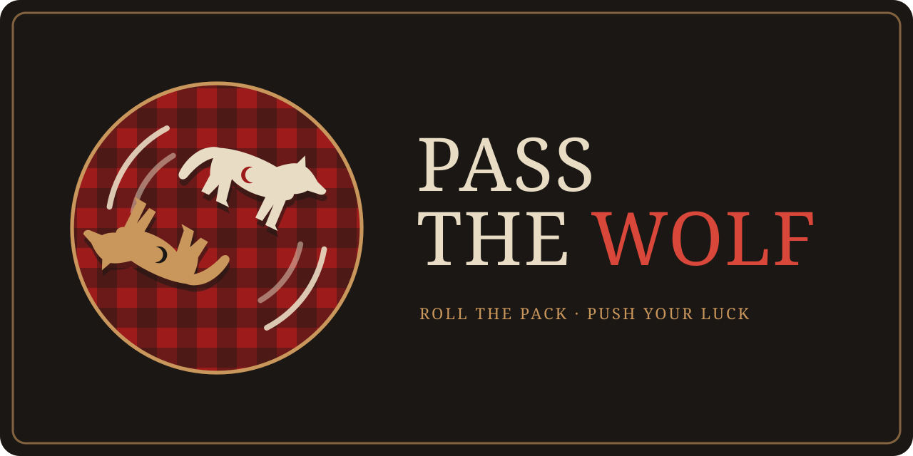

<p align="center"></p>

# Pass the Wolf

A browser push-your-luck dice game. Throw two wolf-shaped dice onto a wool blanket, score by how they land, then roll again or bank before the pack turns on you. First to 100 wins.

The dice are real rigid bodies (Rapier physics). Pose odds come from the wolf's shape, and the point values come from a calibration run of thousands of simulated throws.

## Run it

```bash
npm install
npm run dev        # http://localhost:5173
```

## Scripts

| Script | What it does |
|---|---|
| `npm run dev` | Vite dev server |
| `npm run build` | Typecheck and production build |
| `npm run check` | Typecheck, lint and unit tests |
| `npm run e2e` | Playwright end-to-end tests (run locally before committing; not run in CI) |
| `npm run calibrate` | Headless throw simulation; prints pose frequencies |
| `sh tools/odds.sh <wolf>` | Quick 150-throw odds probe for one direwolf |

## The pack

Five sculpted direwolves: Warden, Stalker, Frostmane, Timber Runner and Old Grizzle. Each seat picks any two. They score from one table but tumble differently; see `docs/calibration.md`. The 3D gallery is at `/wolves.html`.

## Brand

- `brand/logo-mark.svg`: the round mark (also the favicon).
- `brand/logo-banner.svg`: the README banner.
- `brand/social-preview.png`: 1280×640 image for the GitHub repo's social preview (Settings → General → Social preview).
- Rebuild with `node tools/build-brand.mjs`.
