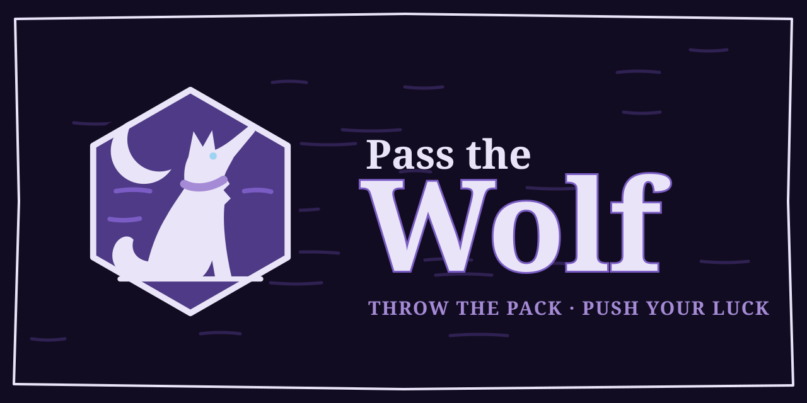
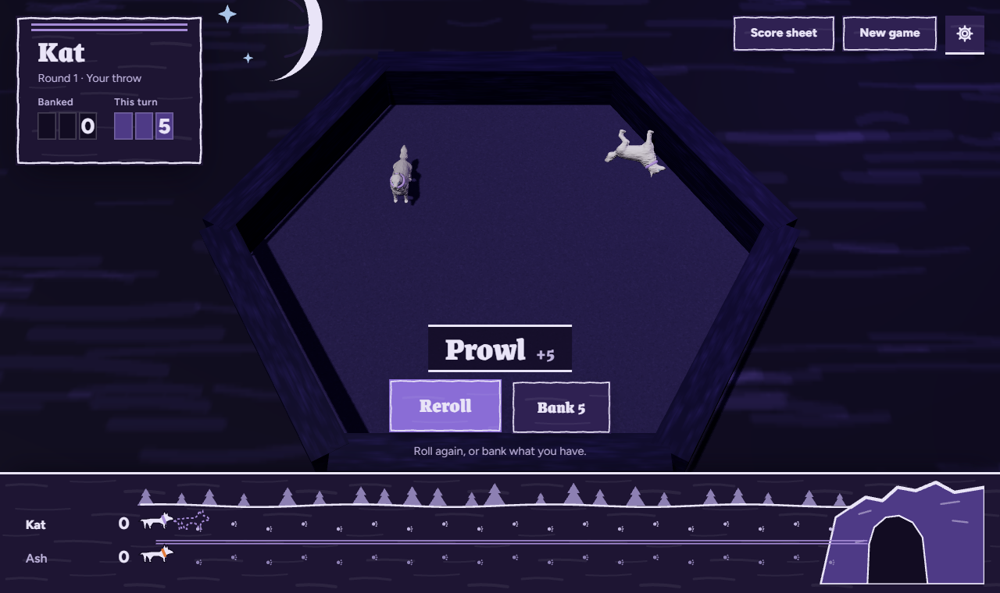
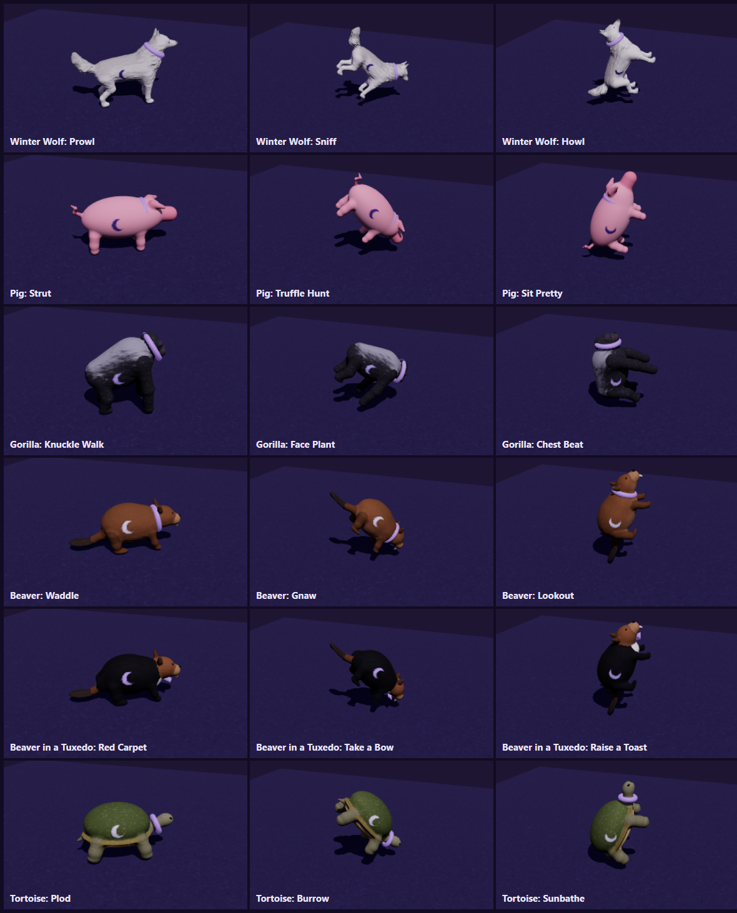
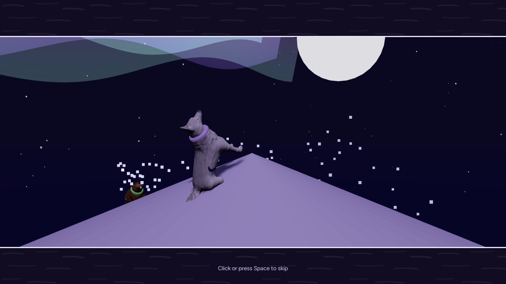

<strong><a href="https://australianraven.github.io/pass-the-wolf/">Play it in your browser</a></strong>

# Pass the Wolf

A push-your-luck dice game where the dice are animals.

Throw two carved wolves into a hexagonal tray. However they land is what you score: on their side, flat on their back, nose down, sitting up howling at the moon. Keep throwing to build your turn, or bank it before your luck runs out. Two wolves on opposite sides lose you the turn. Two wolves tangled together lose you everything you have banked. First to the cave at 100 wins.

It plays in a browser, on one screen passed around the table, or with friends on their own devices.

## How a turn goes

1. **Take the wolves.** Pick them up and fling them by hand, shake them about first if you like, or press Auto-roll (or Space).
2. **See how they land.** The points go into your turn. Big rolls get a slow zoom on the wolves.
3. **Roll again or bank.** Rolling again risks the turn; banking moves your wolf along the trail to the cave.

## How the wolves score

Each wolf scores by how it lands. A matching pair (a double) scores four times one wolf.

| Landing | One wolf | A double |
|---|---|---|
| **Den**: both on the same side | 1 | |
| **Play Dead**: flat on its back | 5 | 20 |
| **Prowl**: standing on its feet | 5 | 20 |
| **Sniff**: nose to the ground | 10 | 40 |
| **Pounce**: nose down, tipped on one shoulder | 15 | 60 |
| **Howl**: sitting up, snout to the sky | 25 | 100 |
| **Scattered**: one on each side | lose the turn | |
| **Tangled**: the wolves touching | lose everything banked | |
| **Alpha**: one wolf riding on the other's back | **win the game** | |

The odds are real. The wolves roll with real physics, and the chances of each landing are tuned against measured odds from the original pig dice game, with the rare Howl added. The Alpha is so unlikely it wins outright.

## The pack

Pick your animal before the game. Each one wears a collar (or a bow tie) in your colour, has its own name for every pose, and flops its ears, tail and legs about as it tumbles. They all roll the same odds, so pick whichever makes you laugh.

**Winter Wolf** · **Pig** · **Gorilla** · **Beaver** · **Beaver in a Tuxedo** · **Tortoise**

## Playing together

- **One screen:** 2 to 6 players pass the mouse round the table. Fill any seat with a computer player.
- **Online:** host a room and send friends the code or link. The game runs directly between your devices.
- **Local network:** no internet needed. Swap a short code with each friend on the same Wi-Fi and play.

## Winning

Reach the cave first and the winner gets a cutscene. There are four. In one, the winner shelters in the cave while a tornado carries everyone else away. In another, they howl from a mountain top as the rest slide off it. In the third, they skate a frozen lake while the ice gives way under the rest. In the fourth, they take the podium while everyone else goes up as fireworks.

## Extras

- [`/demo.html`](https://australianraven.github.io/pass-the-wolf/demo.html): watch a real throw land on any result you pick.
- [`/wins-screens.html`](https://australianraven.github.io/pass-the-wolf/wins-screens.html): set up the players and watch any winner cutscene.

Building it yourself, running the tests or retuning the odds: see [DEVELOPMENT.md](DEVELOPMENT.md).

## Licence

[MIT](LICENSE)
